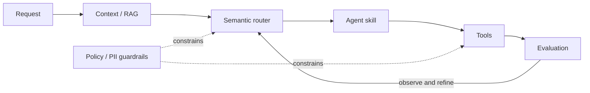

<div align="center">

<!-- Header Banner -->


<br/>

[](https://www.linkedin.com/in/anuragbatra1999/)
<!-- Self-hosted badge-counter will go here once its deployed URL is confirmed. -->

</div>

> Agentic AI Engineer at **Okta** with 6+ years of experience building production LLM systems, multi-agent workflows, AI platforms, and scalable backend services.

- Building skill-based orchestration, semantic routing, enterprise RAG, and secure agent-tool execution.
- Previously built LLM infrastructure, AI developer tooling, observability, and computer-vision services at **SAP Labs India**.
- Two Indian patent filings in AI-assisted agriculture · Springer research publication · Smart India Hackathon winner.

#### `trace --profile`

<div align="center">

</div>

#### `cat current-context.yaml`

```yaml
focus:
  - agent orchestration and semantic routing
  - grounded retrieval and evaluation
  - safe, observable tool execution

toolbox: [Python, Go, LangGraph, MCP, RAG, OpenSearch, pgvector]
engineering_bias: explicit systems · measured workflows · safe defaults
```

#### `system map --overview`



<details>
<summary><b>Engineering log</b> · principles I keep returning to</summary>

```text
[trust]      tools should be explicit
[quality]    evaluate the workflow, not only the final answer
[safety]     constrain side effects and design graceful failure
[operation]  traces, latency, and recovery are part of the feature
```

</details>

<details>
<summary><b>Career notes & credentials</b> · expand</summary>

| Chapter | Notes |
| --- | --- |
| Okta · TDI GenAI | SDE-3; skill orchestration, semantic routing, multi-agent systems, enterprise RAG |
| SAP Labs India | AI Core, LLM proxy services, developer tooling, observability, computer vision |
| Education | M.Tech, Computer Software Engineering · BITS Pilani |
| Certifications | AWS Machine Learning – Specialty · Azure AI Fundamentals · Azure Data Scientist Associate |
| Recognition | Two Indian patent filings · Springer publication · Smart India Hackathon winner |

</details>

---

#### ⚡ Core toolkit

<div align="center">


</div>

---

<div align="center">
  
</div>

<div align="center"><sub>↓ Selected public work is pinned below.</sub></div>

<div align="center"><sub>AGENTIC SYSTEMS · ENGINEERED WITH INTENT</sub></div>
